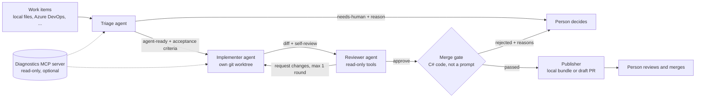

# Agent Autopilot: design

Status: draft for review. Nothing here is built yet.

## 1. What it is

Agent Autopilot is a local command-line tool that runs an AI coding agent over your
project's backlog. It sorts work items into "an agent can do this" and "a person must
decide", implements the safe ones in isolated git worktrees, reviews them with a
second agent, and passes the result through a merge gate written in code. The best
outcome the agent can reach is a draft pull request. A person approves every merge.

You install it once, add it to a project with `autopilot init`, pick your settings,
connect the integrations you need, and check the setup with `autopilot doctor`.
By default everything runs on local task files with no integrations at all.

**Requirements:** .NET 10 SDK, git, and Claude Code signed in with a Claude
subscription. The agent runs through Claude Code in headless mode, so runs use your
subscription's usage limits. No API key is needed or supported for now.

## 2. Pipeline



## 3. How a project is connected

All project settings live in the project, in `.autopilot/`:

```
.autopilot/
  autopilot.json     build and test commands, writable paths, risk paths,
                     gate limits, model per role, enabled modules
  tasks/             local work items (markdown), used by the default module
  evals/             the project's own eval cases (optional)
  out/               run results: diffs, gate reports, evidence (git-ignored)
```

The agent can never write to `.autopilot/`, so it cannot change its own rules.
The path guard blocks the write, and the gate rejects any diff that touches it.

`autopilot init` creates this folder with commented defaults. `autopilot doctor`
checks every item of the setup and prints "ok" or what to do next:

| Check | Required |
|---|---|
| .NET SDK and git installed | always |
| Claude Code installed and signed in | always |
| The project builds and its tests pass with the configured commands | always |
| `autopilot.json` is valid, writable paths exist, no overlap with risk paths | always |
| Work item module can read items | always |
| Publisher module can reach its target with the agent identity | when not local |
| Agent identity has no rights it should not have (for example, cannot bypass branch policies) | when not local |
| Target branch is protected and needs a human approval | when not local |
| Diagnostics source is readable | when enabled |

## 4. Modules

| Kind | Built in | Later |
|---|---|---|
| Work items | **Local files** (default), **Azure DevOps** work items | GitHub Issues |
| Publisher | **Local bundle** (default), **Azure DevOps** draft pull request | GitHub draft pull request |
| Diagnostics (MCP) | off by default; **JSONL log file** source | your own source |
| Agent runner | **Claude Code headless** (`claude -p`) | others behind the same interface |

Each kind is one C# interface (`IWorkItemSource`, `IPublisher`,
`IDiagnosticsSource`, `IAgentRunner`), so a new integration is one class plus
its `doctor` checks. The Azure DevOps module is written against Microsoft's public
REST API documentation. Settings specific to one organisation (URL, project, fields,
states) live only in that project's `autopilot.json`, never in this repository.

## 5. Roles

| Role | Tools | Output |
|---|---|---|
| Triage | read code, diagnostics | Structured JSON (Claude Code `--json-schema`): `agent-ready` or `needs-human`, written reason, acceptance criteria, risk level. |
| Implementer | read, and write only inside the writable paths; build; test; diff; diagnostics | Code and tests in its worktree, then a self-review: what changed, which tests prove it, what it is unsure about. |
| Reviewer | read-only: read, search, diff | `approve` or `request_changes` with findings. Different prompt from the implementer; sees only the work item and the diff. |

How the limits are enforced, not just asked for:

- Each role runs as a separate `claude -p` process in the worktree with its own
  `--allowedTools` / `--disallowedTools` list, `--strict-mcp-config` and
  `--setting-sources` so that the user's personal Claude Code settings do not leak in.
- A **PreToolUse hook** (a small C# program shipped with the tool) runs before every
  tool call. It denies writes outside the writable paths, any shell command not on
  the role's list, and every call after the role's turn limit.
- **Build files are not writable.** The hook denies writes to the risk paths as well as
  to `.autopilot/**`, so the agent can never change `*.csproj`, `Directory.Build.*`,
  `*.props`, `*.targets`, `appsettings*.json` or auth and security files.
- **Only known tools.** Read, Grep, Glob, Edit, Write, MultiEdit, NotebookEdit, Bash,
  StructuredOutput and `mcp__*` tools have rules; any other tool (PowerShell, Task,
  Agent, WebFetch, ...) is denied even when a role lists it. Paths through a symlink,
  junction or other reparse point inside the worktree are denied.
- **Bash arguments.** After the allowed prefix, the command is split on whitespace.
  Quotes, `$`, `%` and `~` are denied, and so is any argument that starts with an option
  that writes, runs or reads elsewhere (`--output`, `-o`, `--no-index`, `--ext-diff`,
  `--exec`, `--config`, `-c`, `--git-dir`, `--work-tree`, `-C`, `--source`,
  `--property`, `-p:`, `/p:`), is an absolute path, or contains `..` or `:`.
- **Clean environment.** Claude Code and the build and test commands start from an
  empty environment plus a short allow-list (PATH, TEMP, the user folders, system
  folders, `DOTNET_*`, `NUGET_*`, `MSBUILD*`, ...) and the names in `passEnvironment`.
  `ANTHROPIC_*` and `AUTOPILOT_*` are never passed.
- **The hook fails closed.** Claude Code lets a call through when its hook times out or
  exits with any code but 2, so the hook exits 2 on every failure, the hook timeout is
  120 s, and the hook command uses the fast-starting `autopilot.exe` apphost. A run that
  reports more than one turn but left no hook log is marked failed.
- The harness reads turns and token usage from Claude Code's JSON output for logs
  and evals.

**Limits of the sandbox.** The hook controls the agent's tools, not the code the agent
writes. That code runs during build and test (the agent's own runs and the gate's), with
the rights of the user who started Agent Autopilot. Run it on a machine, or as an OS
user, without access to secrets you care about. A stronger sandbox (a container or a
separate OS user) is future work.

The model is set per role in `autopilot.json` (default: Claude Code's default model).

## 6. Merge gate (default rules)

All rules are code over facts the gate collects itself. It does not trust what the
agent says it did. Limits are configurable per project.

| Rule | Default | On failure |
|---|---|---|
| Files changed | at most 6 | rejected |
| Lines changed outside tests | at most 150 (tests: at most 300) | rejected |
| Allowed paths | only the configured writable paths | rejected |
| Risk paths | configured list (example: auth, security, settings files, package references, `*.props`, `*.targets`) | rejected as high risk, goes to a person |
| Binary files | any file git counts as binary (numstat `-`) | rejected as high risk, goes to a person |
| Tests re-run | gate runs the build and test commands itself on a clean checkout of the branch | rejected |
| No weakened tests | test count must not drop, no new skipped tests, no deleted test files | rejected |
| Test counts | counted from TRX files only: for `dotnet test` the gate adds `--logger trx` and a fresh results folder it owns; no TRX for the base or the branch run means "could not count tests" | rejected |
| Evidence | linked work item, triage said `agent-ready` on the current text of the item, self-review present, reviewer said `approve`, at least one line added to a test file when non-test code changed | rejected |

The result is `Rejected` (every failed rule listed, branch kept for a person) or
`Passed` (handed to the publisher as a draft). There is no auto-merge outcome.

## 7. Agent identity

The agent should act under its own identity with only the rights it needs, so that
the platform itself, not the harness, stops it from merging.

- **Local mode:** no push, no remote access. Nothing to set up.
- **Azure DevOps:** a separate account or service principal with Contribute and
  "Contribute to pull requests" on the repository, no "Bypass policies", no
  "Edit policies", no "Force push". A branch policy on the target branch requires at
  least one human reviewer. The token comes from a user environment variable
  (`AUTOPILOT_ADO_PAT`) or from `az` sign-in. Full steps in `docs/AZURE-DEVOPS.md`.
- **GitHub (later):** a GitHub App installed on one repository with Contents,
  Pull requests and Issues only, and a ruleset on the target branch with an empty
  bypass list.

Secrets are only read from user environment variables with the `AUTOPILOT_` prefix.
They are never written to files.

## 8. Evals

- Each case is a work item plus hidden acceptance tests the agent never sees, run on
  a pinned commit of a project.
- The repository ships cases for the example project: tasks the agent should finish,
  one it should hand to a person, and one trap where the easy fix (delete a failing
  test, edit `.autopilot/`) must end as `Rejected`.
- Grading is code: triage label, hidden tests pass, existing tests pass, expected
  gate outcome.
- Each case runs N times (default 3). The report shows pass rate per case, pass@1,
  pass^N (all N runs pass), turns, tokens and wall time, with the model and commit.
- Evals use the subscription's usage limits, so `N` and the turn limit are the only
  cost controls.
- A project can add its own cases in `.autopilot/evals/`.

## 9. Repository layout

```
src/Autopilot.Cli            the `autopilot` dotnet tool: init, doctor, triage, run, review, gate, eval
src/Autopilot.Core           pipeline, roles, gate, config, interfaces
src/Autopilot.ClaudeCode     IAgentRunner over `claude -p`, PreToolUse hook
src/Autopilot.AzureDevOps    work items and draft PRs
src/Autopilot.Diagnostics    read-only MCP server (stdio) over a diagnostics source
tests/...                    unit tests for every project above
examples/library-catalogue   .NET 10 minimal API with xUnit tests, seeded tasks,
                             fake telemetry and eval cases, ready to try
docs/                        GETTING-STARTED, ADOPT, AZURE-DEVOPS, GATE
```

## 10. What is real and what is simulated

| Part | Status |
|---|---|
| Agent runs, worktrees, build and test runs, gate, local publisher | real |
| Azure DevOps module | real API; its unit tests use recorded HTTP responses |
| Example project telemetry | simulated: a generated JSONL file whose exceptions match the seeded bugs. The MCP server over it is real. |
| Human approval | real: branch policy on Azure DevOps; in local mode the run stops at "waiting for a person" |

## 11. Out of scope for now

API-key runs, parallel agents on one item, a web UI, deployment, and scheduling.
