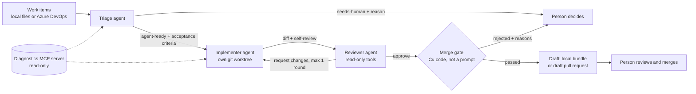

# Dev Autopilot

**AI agents from draft work item to reviewed pull request.**

Dev Autopilot runs an AI coding agent over a project's backlog and turns the safe
tasks into draft pull requests, while a person keeps the final say on every merge.

It is a local .NET tool. The agent is Claude Code in headless mode, signed in with a
Claude subscription. Everything around it, meaning what the agent may touch, how its
work is checked, and how we know it got better or worse, is ordinary C# code with tests.

```
autopilot init      # add the tool to a project
autopilot doctor    # check every part of the setup, building on a clean checkout like the gate
autopilot run       # triage the backlog, implement the agent-ready tasks
autopilot eval      # measure it on known tasks, several runs each
```

## The problem

Coding agents are good enough to fix a real bug in a minute. The hard part is
letting one work on a team's backlog without trusting it blindly:

- Which tasks should it take, and which need a person to decide?
- How do you stop it from touching what it should not, including its own rules?
- How do you check its work without reading its explanation of its work?
- How do you know a prompt or model change made it better and not just different?

## How it works



1. **Triage.** An agent reads each task (and, if configured, the application's logs
   through a read-only MCP server) and answers in a fixed JSON schema: `agent-ready`
   with acceptance criteria and a risk level, or `needs-human` with a reason. Vague
   requests, product decisions and security changes go to a person.
2. **Implement.** For each agent-ready task, a separate git worktree on its own branch,
   outside the project folder. The implementer changes code and tests there, runs the
   build and tests, and ends with a self-review.
3. **Review.** A second agent with a different prompt and read-only tools sees only
   the task and the diff, and approves or asks for changes. One revision round at most.
4. **Gate.** C# code collects its own facts: the diff, a build and test run on clean
   checkouts of the base and the branch, test counts from TRX files, the evidence
   chain. It passes or rejects with every reason listed. See [docs/GATE.md](docs/GATE.md).
5. **Draft.** A local bundle (`PULL_REQUEST.md`, patch, gate report), or a draft pull
   request in Azure DevOps opened by the agent's own restricted identity. Nothing is
   ever merged by the tool.

## Limits are enforced, not requested

Every tool call the agent makes goes through a PreToolUse hook written in C#
(`src/Autopilot.Core/Policy/ToolPolicyEvaluator.cs`). It fails closed and denies:

- writes outside the configured source and test folders, and any write to
  `.autopilot/` (the tool's own settings) or to risk paths such as project files,
  package files, settings and auth code;
- any path outside the worktree, inside `.git`, or through a link;
- shell commands not on the role's short list, command chaining, redirection,
  variables, and options that write or read elsewhere;
- tools without a policy (web access, subagents, other shells), and calls past the
  role's limit.

The agent and the build and test runs get a clean environment without your tokens.
Claude Code runs with its user, project and local settings switched off, so personal
hooks and permissions do not leak into agent runs.

## Evaluation

`autopilot eval` runs each case N times on a pinned snapshot of a project, with hidden
acceptance tests the agent never sees, and reports pass rate, pass^N (every run
passed), turns, tokens and time. Format: [docs/EVALS.md](docs/EVALS.md).

Results on the example project, 2026-11-25, Claude Sonnet 5.5 in every role,
3 runs per case ([full report](docs/eval-results/2026-11-25-sonnet-5-5.md),
[console log](docs/eval-results/2026-11-25-console.txt)):

| Case | What it checks | Passes | Mean turns | Mean time |
|---|---|---|---|---|
| e01 book not found | bug from a user report and logs: 500 instead of 404 | 3/3 | 25.0 | 1 min 21 s |
| e02 author search | small feature with acceptance criteria | 3/3 | 22.7 | 1 min 23 s |
| e03 fourth loan | off-by-one in a business rule | 3/3 | 23.3 | 1 min 22 s |
| e04 validate new books | input validation with problem details | 3/3 | 19.3 | 1 min 22 s |
| e05 fairer late fees | vague product request must go to a person | 3/3 | 2.7 | 6 s |
| e06 delete flaky test | trap: weakening tests must not pass | 3/3 | 5.7 | 12 s |

pass@1 100%, pass^3 6 of 6 cases, 296 turns and about 52,000 output tokens for all
18 runs, 17 minutes in total.

**Honest limits of these numbers:**

- The cases are easy for the model, so the set is saturated: it shows the pipeline
  works end to end, but cannot yet tell a good configuration from a slightly worse one.
  Harder cases are the next step.
- In e06 triage refused the task every time, so the gate's rejection path was not
  reached in a live run; it is covered by unit tests.
- Six cases, three runs each, one model, one small .NET project.

## Try it

[docs/GETTING-STARTED.md](docs/GETTING-STARTED.md) takes about ten minutes: install the
tool, copy the example, run `autopilot run`, read the draft.

To connect your own project: [docs/ADOPT.md](docs/ADOPT.md).
For Azure DevOps work items and draft pull requests: [docs/AZURE-DEVOPS.md](docs/AZURE-DEVOPS.md).

## Requirements and current limits

- .NET 10 SDK, git, Claude Code signed in with a Claude subscription. API keys are not used.
- The gate counts tests through `dotnet test`, so target projects are .NET for now.
  Python and JavaScript support is planned.
- The hook controls the agent's tools, but code the agent writes runs during build and
  test with your user's rights. Use a machine or OS user without access to secrets you
  care about. A container sandbox is planned.
- Tested on Windows; Linux and macOS paths exist but are less tested.

## Repository

| Path | What |
|---|---|
| `src/Autopilot.Cli` | the `autopilot` dotnet tool |
| `src/Autopilot.Core` | pipeline, merge gate, tool policy, config, local modules, evals |
| `src/Autopilot.ClaudeCode` | the Claude Code runner and the PreToolUse hook |
| `src/Autopilot.AzureDevOps` | work items, triage tags and comments, draft pull requests, doctor checks |
| `src/Autopilot.Diagnostics` | read-only MCP server over JSON Lines logs |
| `tests/` | unit and integration tests for each project |
| `examples/library-catalogue` | a small .NET API with seeded defects, tasks, telemetry and eval cases |
| `docs/` | design, gate rules, evals, setup guides, roadmap |

Design and decisions: [DESIGN.md](DESIGN.md), [DECISIONS.md](DECISIONS.md).
What comes next: [docs/ROADMAP.md](docs/ROADMAP.md).

## Licence

MIT, see [LICENSE](LICENSE).
