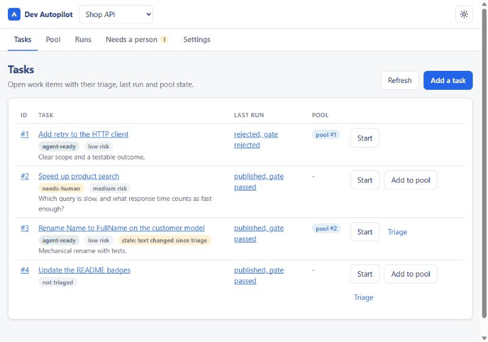
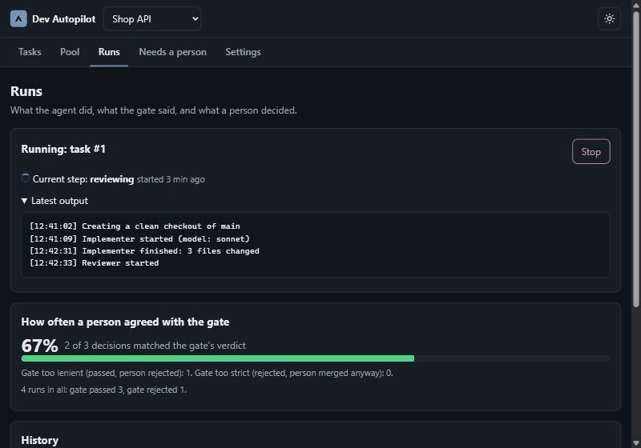
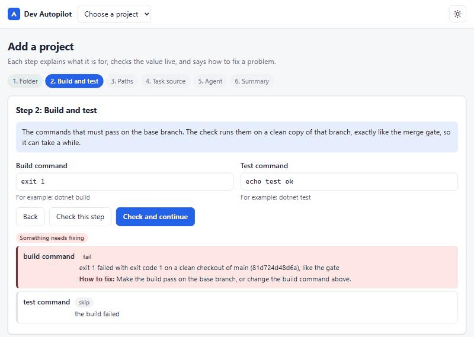
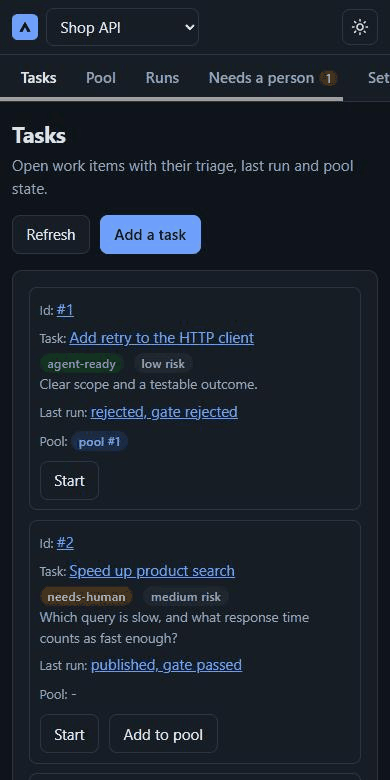

# The local web UI

`autopilot ui` starts a small web page on your own computer. It is a second way to use the
same services as the command line: the pages call the same code for the task list, the pool,
runs, schedule, settings and the `doctor` checks. Nothing runs in the cloud, nothing is
loaded from the internet, and the page works offline.

```powershell
autopilot ui                       # the default workspace, port 5178
autopilot ui --port 6000 --open    # another port, and open the browser
autopilot ui --workspace D:\autopilot-data
```

The command prints a link such as `http://127.0.0.1:5178/?key=...`. Open it once: the key signs
the browser in and works one time only. Stop the UI with Ctrl+C. To sign in again, start it again.

## Who can use it

The UI is meant for one person on one computer.

- It listens on `127.0.0.1` only, never on a network address.
- The one-time key in the first link becomes a session cookie (`HttpOnly`, `SameSite=Strict`).
  Every call to `/api` needs that cookie.
- Every change (POST, PUT, DELETE) also needs the header `X-Autopilot-Request` and an `Origin`
  that matches the page's own address, so another web page in your browser cannot send changes.
- Only the host names `localhost`, `127.0.0.1` and `[::1]` are answered, which stops DNS
  rebinding.
- The pages are compiled into the tool and served with a strict content policy: scripts, styles
  and requests come from the page itself, nothing else.
- Secrets are never shown or stored. Settings hold the *names* of environment variables only. A
  field that should hold a name refuses anything that looks like a pasted token.

## Screens

The header has a project switcher and a light/dark switch. The pages work down to phone width.

**Projects.** The projects of the workspace, and *Add a project* (the wizard below).

**Tasks.** Open work items with their triage (agent-ready or needs-human, the risk, and a
*stale* mark when the text changed after triage), the last run and the pool position. For
local tasks you can add and edit a task, comment, close and reopen. *Start* runs one task in the
background; *Add to pool* queues it; *Triage* asks the agent to triage it again. A task that
belongs to a tracker is read-only here.

**Pool.** The queue in the order the agent works through it. Move, remove, *Run now* (optionally
with a limit), and *Run at night*: the page shows the exact command and the tasks that would run,
and installs the schedule only after you confirm.

**Runs.** The current step of an active job with the latest output and a *Stop* button that stops
that one job only (other jobs and the pool run are not touched). Below: how often your decision
matched the gate's verdict, and the history. A run page shows the gate report, the draft
description, the diff and the build log, and two buttons to record whether you merged or rejected
the draft. Merging itself is always done by a person in their own tool.

**Needs a person.** Tasks that triage could not decide, with the agent's question. Your answer is
stored on the task twice: as a comment, and as a section of the task text, so the next triage and
the agent read it. The changed text also marks the old triage stale.

**Settings.** The setup steps below on one page, plus:

- *Merging*: shown as "merged by a person". It cannot be changed.
- *Trust*: `ask`, `safe` or `high`. `ask` means every result waits for a person; it is the only
  level with behaviour today. `safe` and `high` are stored for later (see D-013).
- *Context documents*: edit the files the agents read before each run. The agent cannot change
  them. They must be listed under "Context documents" in the Paths section, and they are read from
  the base branch, so commit them there.

## The add-project wizard

Six steps. Each shows what it is for, the current value, a live check and, when a check fails, a
fix in plain words. The checks run the same code as `autopilot doctor`, against a temporary copy of
your draft, so nothing is saved until the end.

| Step | You set | What is checked |
|---|---|---|
| 1 Folder | repository folder, base branch, key | the folder exists and is a git repository root; the branch exists |
| 2 Build and test | the two commands | both run on a clean copy of the base branch, like the gate does (this can take a while) |
| 3 Paths | writable paths, risk paths, context documents | the writable paths exist |
| 4 Task source | local tasks, or Azure DevOps | for Azure DevOps: the variable names, whether each variable is set on this computer (its value is never read into the page), the connection checks of `doctor`, and a paged preview of the work items the query returns |
| 5 Agent | commit name and address, models, limits | the settings are valid |
| 6 Summary | | every required check runs once more; *Create the project* is enabled only when none fails |

A step passes only when its checks ran and passed: a skipped build check does not count. The server
checks again when you create the project, so a script cannot skip the checks either.

After setup the Settings page shows the same sections, each with its own *Check* button and one
*Save settings* button. Nothing is saved when a value is invalid, and the page lists every problem.

## Screenshots

| | |
|---|---|
|  |  |
|  |  |

## Limits

- One run at a time per project. *Start* and *Run now* are refused while another run holds the
  project; the pool run is not a job, so *Stop* applies to jobs started with *Start*.
- *Needs a person* can answer local tasks only. For Azure DevOps tasks, answer in the tracker.
- The page does not refresh by itself except while a run is active.
- The Azure DevOps step shows what `doctor` and `autopilot ado check` report (sign-in, query, work
  item read and write, branch rights, branch policy) and the same paged preview as
  `autopilot ado preview`. The preview and the checks change nothing in Azure DevOps.

## For developers

`src/DevAutopilot.Web` is a class library with a minimal API. `WebUi.Build` takes a `WebUiOptions`;
tests build it with an in-memory server and fakes for the checker, the process launcher, the process
killer and the scheduler. Endpoints (in `Endpoints.cs`) call one service method each; the logic
lives in `SetupService`, `TaskOperations`, `PoolOperations`, `RunOperations` and the core services.
The command line project supplies the parts the library cannot reference (the `doctor` checks, the
defaults for a folder, the tracker modules) through `ISetupChecker`, `IAzureDevOpsProbe` and
`IWorkItemSourceFactory`. The pages are plain ES modules in `wwwroot/`, embedded in the assembly.
There is no build step and no package manager.
