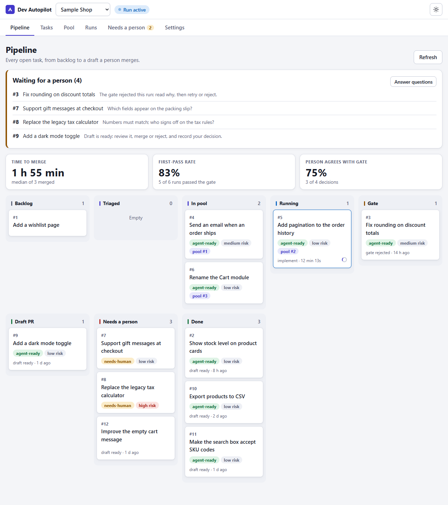
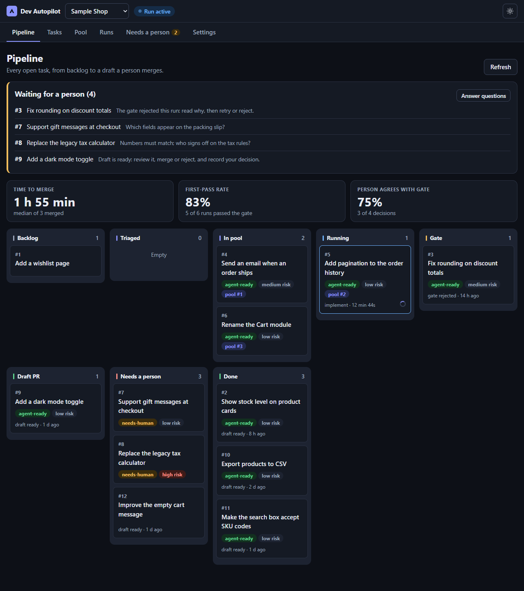
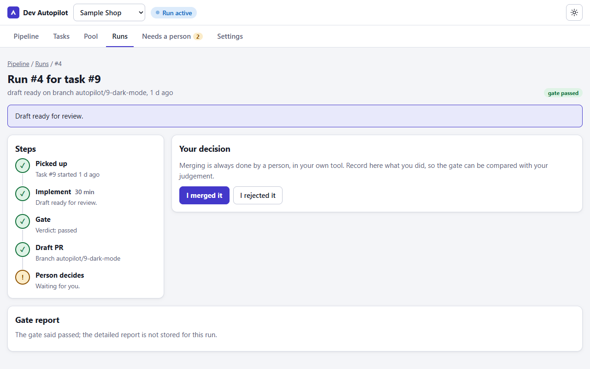
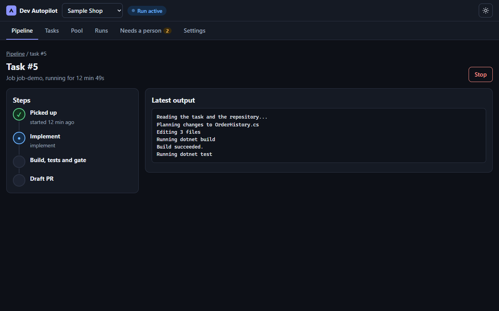
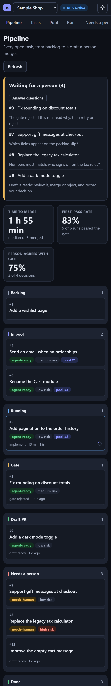

# The local web UI

`autopilot ui` starts a small web page on your own computer. It is a second way to use the
same services as the command line: the pages call the same code for the task list, the pool,
runs, schedule, settings and the `doctor` checks. Nothing runs in the cloud, nothing is
loaded from the internet, and the page works offline.

```powershell
autopilot ui                       # http://localhost:<port>, opens the browser
autopilot ui --no-open             # do not open the browser
autopilot ui --port 6000           # a port of your choice for this run
autopilot ui --workspace D:utopilot-data
```

There is nothing to sign in to. `autopilot ui` listens on `127.0.0.1`, prints
`http://localhost:<port>/` and opens it. Stop it with Ctrl+C.

**The port** is picked once per machine from 5100-5999 the first time you start the UI, saved in the
workspace and reused on every start, so the address and your bookmarks stay the same. If that port is
busy, the next free one is used for that run (and printed and opened); the saved one is kept.
`--port N` uses N for that run only, and `--port 0` lets the system choose.

**Always on.** The UI can start when you sign in to the computer, without administrator rights:

```powershell
autopilot ui install      # Windows: a script in the Startup folder. Linux: a systemd user unit
                          # (restart on failure). macOS: a launchd agent (kept alive).
autopilot ui status       # the address, whether it runs, whether it starts at sign-in, key setting
autopilot ui uninstall    # remove it again
```

A UI started this way does not open a browser. The Windows Startup script has no restart on
failure and no log file; run `autopilot ui` in a terminal to see the request log.

**Slow pages.** The footer shows how long the last call took in the browser and on the server. The
terminal that runs `autopilot ui` prints one line per request (`--quiet` turns that off).

## Who can use it

The UI is meant for one person on one computer. The protection is invisible:

- It listens on `127.0.0.1` (and `[::1]`) only.
- Only the host names `localhost`, `127.0.0.1` and `[::1]` are answered. A web page on the internet
  cannot reach the UI by pointing its own name at your computer (DNS rebinding).
- Every change (POST, PUT, DELETE) needs the header `X-Autopilot-Request` and an `Origin` that
  matches the page's own address, so another web page in your browser cannot send changes.
- The pages are compiled into the tool and served with a strict content policy: scripts, styles
  and requests come from the page itself, nothing else.
- Secrets are never shown or stored. Settings hold the *names* of environment variables only. A
  field that should hold a name refuses anything that looks like a pasted token.

### A key, for shared machines

On a computer that other people use, turn on a key:

```powershell
autopilot ui require-key on     # off again with: autopilot ui require-key off
autopilot ui link               # prints http://localhost:<port>/?key=...
autopilot ui link --rotate      # a new key: every browser signed in so far is signed out
```

The key is stored in the workspace and does not change between starts. The link signs a browser in
once: it gets a cookie (`HttpOnly`, `SameSite=Strict`, one year), and the API answers only with it.
The key is required automatically, and cannot be switched off, when the UI is bound to anything but
loopback (`autopilot ui --bind 0.0.0.0`); in that case other host names are served too and the key
is the only protection. Restart a running UI after changing the setting.

### Threat model

What the UI protects against, and what it does not.

| Threat | Handling |
|---|---|
| A web page in your browser sends requests to `localhost` | Changes need a custom header and a matching `Origin`; a page from another site cannot set both. Reads are answered, but the browser does not show the answer to another site. |
| DNS rebinding (a name that points at 127.0.0.1) | The `Host` header must be a loopback name; anything else gets 400. |
| Another person on the same machine | Not stopped by default (any local process can open the port). Turn on the key; it is a speed bump for a casual user, not a boundary against someone who can read your files. |
| Another computer on the network | Not reachable: loopback only. `--bind` beyond loopback forces the key. |
| An agent that Autopilot runs (it executes as you) | It can open the port like any local program. The agent runs behind the hook and the sandbox of Claude Code; deny the UI port there so an agent cannot call the UI. Settings that widen rights (settings, risk paths, trust, schedule, merge policy) should be changed from the page only. The real fix is to run agents as a separate operating-system user, which is on the roadmap. |

Not done yet: an action log that shows where each request came from, and the agent deny rule for the
UI port. Both are tracked as tasks.

## Screens

The header has a project switcher, a status chip (*Idle* or *Run active*) and a light/dark switch.
The theme follows the system until you press the switch. The pages work down to phone width.

**Pipeline.** The first page of a project. Every open task is a card in a lane: *Backlog*,
*Triaged*, *In pool*, *Running*, *Gate*, *Draft PR*, *Needs a person* and *Done*. A card shows the
id, title, triage label, risk, and the current step with its elapsed time. Above the board,
*Waiting for a person* lists what needs you now: questions from triage, drafts to review and runs
the gate rejected. The funnel strip shows the median time to merge, the first-pass rate (runs that
passed the gate) and how often a person agreed with the gate; a figure with no data yet is hidden.
A running card opens the live job (steps, latest output, *Stop*); a finished card opens the run.

**Projects.** The projects of the workspace, and *Add a project* (the wizard below).

**Tasks.** Open work items with their triage (agent-ready or needs-human, the risk, and a
*stale* mark when the text changed after triage), the last run and the pool position. For
local tasks you can add and edit a task, comment, close and reopen. *Start* runs one task in the
background; *Add to pool* queues it; *Triage* asks the agent to triage it again. A task that
belongs to a tracker is read-only here.

**Pool.** The right side starts with the pool card: its state, the integration branch, one main button (*Run pool*; while a run is active it becomes *Follow the run*) and a *...* menu. Under it a five-step strip (Planned, Running, Waiting for you, Final PR, Done) with small chips for what the current step is doing, and a progress strip (done, running, waiting for you, queued) with one line: tasks done, agent runs of the day and a rough time left, or an estimate before the first run. The queue shows five rows, then *Show N more*; each row has the task number, a one-line title, one status and a menu (*Move to top*, *Move up*, *Move down*, *Open task*, *Remove from pool*). Events list what the run did, newest first. *Run pool* asks first: the counts by readiness, the agent runs against the daily limit, the integration branch and the settings in use; *Confirm and run* starts the run (optionally with a limit on tasks). The left column keeps one line per setting: agents at once, the unattended switch, the pool master, the daily limit of agent runs, the usage stop, the integration branch and the schedule (date, repeat, stop time; it is installed only after you confirm the plan; see [POOL.md](POOL.md)). Below the queue: the final PR, parked tasks and the pool master's decisions (with undo). The page refreshes by itself every few seconds. On a phone the order is status, events, queue, then the settings in a closed section.

**Runs.** The current step of an active job with the latest output and a *Stop* button that stops
that one job only (other jobs and the pool run are not touched). Below: how often your decision
matched the gate's verdict, and the history. A run page shows the gate report, the draft
description, the diff and the build log, and two buttons to record whether you merged or rejected
the draft. Merging itself is always done by a person in their own tool.

**Needs a person.** Tasks that triage could not decide, with the agent's question. When the question
has options, each is a button and the recommended one is first and highlighted: one click saves it
(a note in the box is added to it). Or write your own answer. Your answer is stored on the task
twice: as a comment, and as a section of the task text, so the next triage and the agent read it.
The changed text also marks the old triage stale. With *Save and continue* (on by default) the
task is also put in the pool and triaged again; *Triage all answered* does that for every answered
task, one after the other. Saving one answer redraws only that card, and text typed in other
cards is kept. Triage returns the options and its recommendation as fields; results stored before
that are read from the "(A) ... (B) ... I recommend B" wording.

**Settings.** The setup steps below on one page, plus:

- *Merging*: shown as "merged by a person". It cannot be changed.
- *Trust*: `ask`, `safe` or `high`. `ask` means every result waits for a person; it is the only
  level with behaviour today. `safe` and `high` are stored for later (see D-013).
- *Context documents*: edit the files the agents read before each run. The agent cannot change
  them. They must be listed under "Context documents" in the Paths section, and they are read from
  the base branch, so commit them there.

## The add-project wizard

You choose the repository folder and press *Analyze the folder*. Autopilot reads the folder
(it writes nothing, uses no model and sends nothing anywhere) and fills in every setting. The next
page, *Review the project*, shows all of it at once:

- **What still needs you.** Only what the folder cannot tell: a build or test command it could not
  find or only guessed (low confidence), no source folder, a branch it is unsure about, the name of the
  environment variable that holds your Azure DevOps token. Nothing else is asked.
- **Sections** for the project (base branch, key, name), build and test, paths and context
  documents, and the task source. Every prefilled value is editable and sits under a
  *What was detected* list: a *detected* badge, the value, the file or rule that produced it
  ("Solution file Shop.sln", "origin/HEAD points to main", "remote origin is an Azure DevOps
  repository") and a confidence (high, medium or low).
- **Checks.** Every required check runs on the final values: the folder is a git repository, the base
  branch exists, the build and the tests pass on a clean checkout of the base branch (this can take
  a few minutes), the paths exist, and for Azure DevOps the variables are set and the connection works.
  *Create the project* is enabled only when none fails; the server checks again when you create it.

What the analysis looks for is described in the decision record D-017 (stacks, commands, writable and
risk paths, rule documents, the task source from the remote). A folder inside a repository means the
whole repository. A folder that is not a git repository is analyzed too, and the checks ask you to
run `git init` and make a first commit. The command line has the same analysis: `autopilot project
analyze <folder>` and `autopilot project add <key> --repo <folder> --detect`.

**Advanced.** *Go through the settings step by step* opens the older six step view of the same
settings. Each step explains what it is for, shows the detected evidence, checks the value live and,
when a check fails, says how to fix it. The checks run the same code as `autopilot doctor`, against a
temporary copy of your draft, so nothing is saved until the end.

| Step | You set | What is checked |
|---|---|---|
| 1 Folder | repository folder, base branch, key | the folder exists and is a git repository root; the branch exists |
| 2 Build and test | the two commands | both run on a clean copy of the base branch, like the gate does (this can take a while) |
| 3 Paths | writable paths, risk paths, context documents | the writable paths exist |
| 4 Task source | local tasks, or Azure DevOps | for Azure DevOps: the variable names, whether each variable is set on this computer (its value is never read into the page), the connection checks of `doctor`, and a paged preview of the work items the query returns |
| 5 Agent | commit name and address, models, limits | the settings are valid |
| 6 Summary | | every required check runs once more; *Create the project* is enabled only when none fails |

A step passes only when its checks ran and passed: a skipped build check does not count. The server
checks again when you create the project, so a script cannot skip the checks either.

After setup the Settings page shows the same sections, each with its own *Check* button and one
*Save settings* button. Nothing is saved when a value is invalid, and the page lists every problem.

## Screenshots

| | |
|---|---|
|  |  |
|  |  |
|  |  |

## Limits

- One run at a time per project. *Start* and *Run now* are refused while another run holds the
  project; the pool run is not a job, so *Stop* applies to jobs started with *Start*.
- *Needs a person* can answer local tasks only. For Azure DevOps tasks, answer in the tracker.
- The page does not refresh by itself except while a run is active.
- The Azure DevOps step shows what `doctor` and `autopilot ado check` report (sign-in, query, work
  item read and write, branch rights, branch policy) and the same paged preview as
  `autopilot ado preview`. The preview and the checks change nothing in Azure DevOps.

## For developers

`src/Autopilot.Web` is a class library with a minimal API. `WebUi.Build` takes a `WebUiOptions`;
tests build it with an in-memory server and fakes for the checker, the process launcher, the process
killer and the scheduler. Endpoints (in `Endpoints.cs`) call one service method each; the logic
lives in `SetupService`, `TaskOperations`, `PoolOperations`, `RunOperations` and the core services.
The command line project supplies the parts the library cannot reference (the `doctor` checks, the
defaults for a folder, the tracker modules) through `ISetupChecker`, `IAzureDevOpsProbe` and
`IWorkItemSourceFactory`. The pages are plain ES modules in `wwwroot/`, embedded in the assembly.
There is no build step and no package manager.
